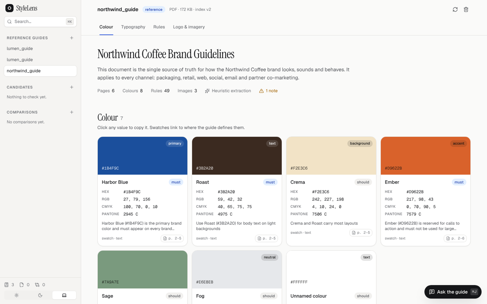
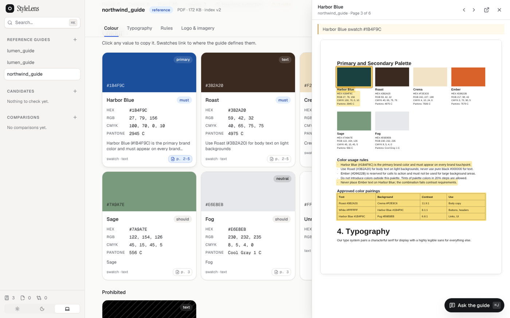
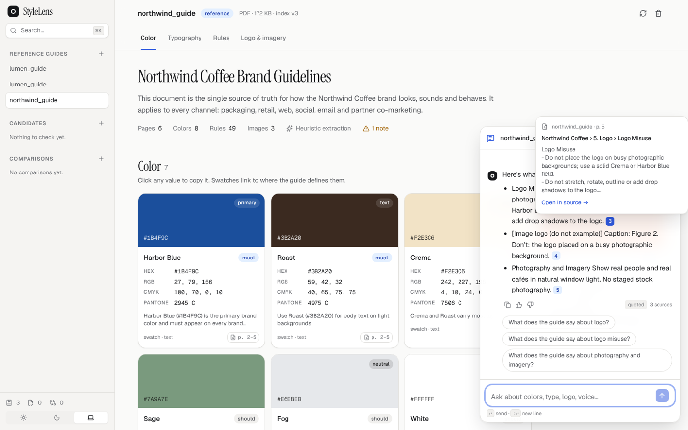
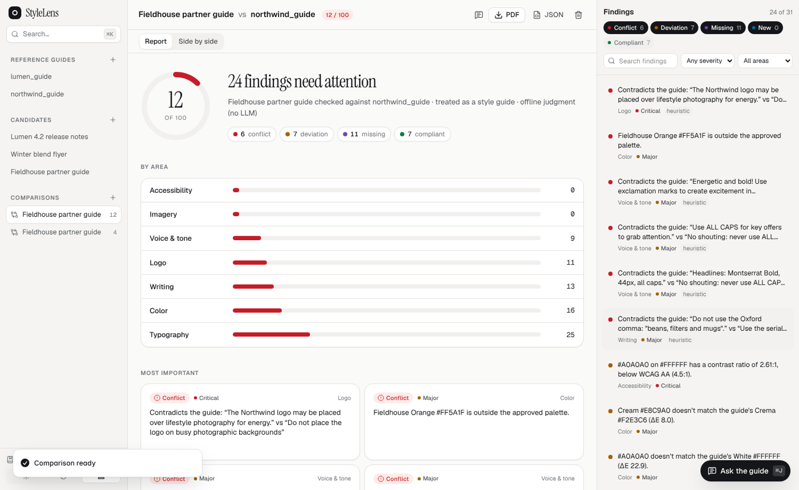
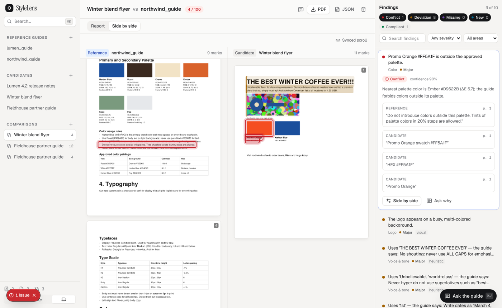
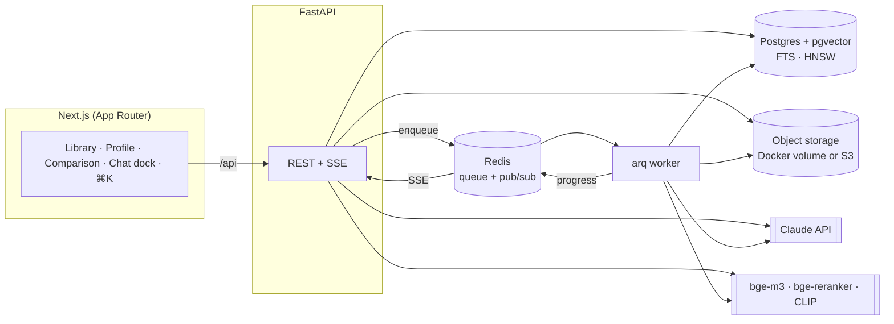

# StyleLens

StyleLens reads brand and style guides the way a design lead would. It extracts the colour
palette, type system, logo and imagery rules, voice and writing rules into one canonical schema,
checks any other document against that guide, and answers questions with citations that open the
exact highlighted passage.



| | |
|---|---|
|  |  |
|  |  |

## What it does

1. **Upload a reference guide.** PDF, DOCX, PPTX, Markdown, TXT, HTML, PNG/JPG/WebP and SVG are
   supported. Live progress streams through *parsing → extracting → chunking → embedding → indexing*.
2. **Review the Guide Profile.** It shows colour swatches (click to copy HEX/RGB/CMYK/Pantone),
   WCAG contrast pairs, live type specimens, rule cards grouped by area with must/should/may badges,
   and every logo and image classified as do/don't. Every item links to its source page, with the
   region highlighted.
3. **Upload a document to check.** This can be another style guide, a marketing asset, a deck, a
   web page or copy.
4. **Run a comparison.** You get a cited compliance report (compliant / deviation / missing / conflict / new) with an
   overall score, a per-area breakdown, a side-by-side view with synced scrolling and linked highlights,
   and PDF/JSON export.
5. **Ask the guide.** A streaming chat dock answers only from the guide, with numbered citations.
   Hovering a citation previews it; clicking opens the highlighted source. Asking the same question
   twice returns the same answer and citations, and if the guide doesn't cover something, the
   assistant says so.

Also included: ⌘K command palette with full-text search inside guides, keyboard shortcuts (`?`),
light/dark/system themes, toasts for background jobs, an accessible UI (axe: 0 violations on the main
pages in both themes), `prefers-reduced-motion` support, and layouts down to tablet width.

## Quick start

```bash
cp .env.example .env          # add ANTHROPIC_API_KEY (or GEMINI_API_KEY, see below) for full extraction, chat and LLM judgment
docker compose up --build     # web on http://localhost:3000, API on http://localhost:8000
```

The first ingestion downloads the local retrieval models (bge-m3, bge-reranker-v2-m3 and CLIP,
about 3.5 GB) into the `models` volume. Allow roughly 8 GB of RAM for the full stack.

**Without an API key** everything still runs. Rules are extracted heuristically, chat answers
quote the guide directly ("extractive" mode, still cited), and comparisons use deterministic
checks plus an offline polarity/value judge. The UI marks these modes.

### Local development (without Docker)

```bash
docker compose up -d postgres redis                 # or bring your own Postgres 16 + pgvector, Redis
python -m venv .venv && . .venv/bin/activate
pip install -e "backend[dev,ml,ocr]"                # tesseract-ocr binary needed for OCR
make migrate
make api        # uvicorn on :8000   (JOB_MODE=inline runs jobs in-process; otherwise also run `make worker`)
make worker     # arq background worker
make web        # Next.js on :3000 (cd frontend && npm install first)
```

For fully offline work, such as CI or machines without the ML extra, set
`EMBEDDING_MODEL=hash:1024 RERANKER_MODEL=lexical IMAGE_EMBEDDING_MODEL=hist`. These are
deterministic test models, not substitutes for bge.

## Architecture



| Layer | What's there |
|---|---|
| **Ingestion** (`backend/stylelens/ingestion`) | One parser interface. Layout-aware PyMuPDF parser for PDF/SVG (headings with inferred levels, lists, tables, images, vector colour swatches, span fonts, page renders, OCR for scanned pages and text in images), plus python-docx, python-pptx, html.parser, Markdown/text and image (OCR) parsers. Every element stores its page, bbox and heading path. |
| **Extraction** (`extraction/`) | Colours from text (HEX/RGB/CMYK/HSL/Pantone), swatches and pixels (k-means in Lab), merged by CIEDE2000, with names, roles and prohibited colours, then LLM-reviewed. Typography from type-scale tables and declarations. Atomic rules via LLM under a strict JSON schema (with element-id citations), or heuristics without a key. Image descriptions from a vision model. All of it lands in the **Canonical Style Schema** (`schema/profile.py`). |
| **Retrieval** (`retrieval/`) | Parent/child chunks that follow the heading hierarchy (tables and list items are never split), image chunks, and contextual headers. Search combines query rewriting from chat history (plus optional multi-query) and intent classification with Postgres FTS and pgvector, fuses them with RRF (ties broken by chunk id), reranks with a cross-encoder and applies a relevance threshold. Context is expanded to parent sections with stable source numbers. Every index is versioned per `GuideVersion`, and re-ingesting creates a new version. |
| **Chat** (`chat/`) | SSE streaming. Grounded answers come from a versioned prompt. Citation verification drops invalid ids and flags unsupported claims, checked lexically (exact values must match) and by a verifier model. There are follow-up suggestions and feedback. |
| **Comparison** (`compare/`) | Section alignment uses the same hybrid retrieval. Deterministic checks cover colour (exact, near, deviation, prohibited, off-palette, missing), WCAG contrast, typography, phrasings mined from the reference's own don't-rules, and visual similarity to the guide's don't examples. The LLM judge returns strict JSON whose citations must resolve to real chunks. Missing-rule detection and per-category scoring follow, with PDF/JSON export. |
| **LLM layer** (`llm/`) | Provider-agnostic roles (`generation`, `extraction`, `vision`, `fast`) configured as `provider:model` (`anthropic:` or `gemini:`). Prompts are versioned files in `/prompts`. Responses are cached by content hash. |

### Consistency (same question, same answer)

- Current Claude models accept only default sampling parameters, and API version `2026-10-21` rejects
  `temperature`, so StyleLens does not rely on temperature 0. Consistency comes from:
  - deterministic retrieval: stable tie-breaking in fusion and reranking, and a fixed threshold;
  - a response cache keyed by *(prompt version, model, standalone question, retrieved chunk ids, index
    version, embedding/reranker models, comparison state)*. Answers depend only on the standalone
    question and its sources, so the same question returns the same answer and citations in any
    conversation;
  - immutable index versions. Re-ingesting a guide creates a new version, which invalidates the cache.
- Retrieval results, structured extractions and verifier verdicts are cached the same way.

## Configuration

All settings are environment variables (see `.env.example`):

| Variable | Default | Notes |
|---|---|---|
| `ANTHROPIC_API_KEY` | – | Enables LLM extraction, vision, chat generation and judgment |
| `LLM_GENERATION_MODEL` / `LLM_EXTRACTION_MODEL` / `LLM_VISION_MODEL` / `LLM_FAST_MODEL` | `anthropic:claude-opus-5-5` | Point extraction/fast at `claude-sonnet-5-5` or `claude-haiku-5-5` to cut cost |
| `GEMINI_API_KEY` | – | Alternative to Claude: set it and point the four `LLM_*_MODEL` roles at `gemini:gemini-flash-latest` (or another Gemini model id) |
| `LLM_REFUSAL_FALLBACK` | `default` | Server-side refusal fallback, Anthropic only (`off` to disable) |
| `EMBEDDING_MODEL` / `EMBEDDING_DIM` | `local:BAAI/bge-m3` / `1024` | Or `hash:1024` for offline tests |
| `RERANKER_MODEL` | `local:BAAI/bge-reranker-v2-m3` | Or `lexical`, `none` |
| `IMAGE_EMBEDDING_MODEL` | `local:clip-ViT-B-32` | Or `hist`, `none`; falls back to `hist` if CLIP can't load |
| `RETRIEVAL_CANDIDATES` / `RERANK_TOP_K` / `RERANK_THRESHOLD` / `RRF_K` / `MULTI_QUERY` | 50 / 6 / reranker default / 60 / false | Retrieval tuning |
| `DELTA_E_EXACT` / `DELTA_E_NEAR` | 1.0 / 3.0 | Colour match thresholds (CIEDE2000) |
| `STORAGE_BACKEND` | `local` (a Docker volume in compose) | `s3` for S3 or any S3-compatible store; settings `S3_*` |
| `JOB_MODE` | `arq` | `inline` runs jobs inside the API process |

## API

`POST /guides` (multipart upload) · `GET /guides` · `GET /guides/{id}` · `GET /guides/{id}/profile` ·
`GET /guides/{id}/ingestion-status` · `GET /guides/{id}/events` (SSE) · `POST /guides/{id}/reingest` ·
`GET /guides/{id}/pages` · `GET /guides/{id}/elements` · `GET /guides/{id}/file` ·
`POST /comparisons` · `GET /comparisons` · `GET /comparisons/{id}` · `GET /comparisons/{id}/events` (SSE) ·
`GET /comparisons/{id}/export?format=pdf|json` ·
`POST /chat` (SSE: `status`, `sources`, `token`, `citations`, `followups`, `done`) ·
`GET /conversations/{id}/messages` · `POST /messages/{id}/feedback` ·
`GET /chunks/{id}` (citation preview) · `POST /search`. OpenAPI docs are at `/docs`, and the
frontend types are generated from them (`make types`).

## Tests and evaluation

```bash
make test        # backend: parsers, colour maths (CIEDE2000 reference data, WCAG), schema validation,
                 # chunking, retrieval, citation verification, chat, comparison, end-to-end flows
make test-web    # TypeScript + ESLint
make eval        # retrieval metrics; add --answers / --compare (see `python -m stylelens.eval.run -h`)
```

The golden set (`backend/stylelens/eval/golden`) has two sample guides, 48 questions with expected
sections and answer keywords, 4 out-of-scope questions, and three candidate documents with seeded
deviations. The samples are generated by `stylelens.eval.samples`. Eval runs use a separate
`<db>_eval` database.

Results in the development sandbox, using **offline test models** (hashing embedder, lexical
reranker, no LLM):

| Retrieval | | Answers (extractive) | | Comparison (seeded) | |
|---|---|---|---|---|---|
| Recall@1 / @3 / @5 | 0.98 / 1.0 / 1.0 | citation support | 1.0 | issue recall | 1.0 |
| MRR / nDCG@5 | 0.99 / 0.99 | invalid citations | 0 | precision on issues | 1.0 |
| false abstentions | 0 | consistency (same answer twice) | 1.0 | findings with valid citations | 32/32 |
| correct abstentions | 3 / 4 | keyword accuracy | 0.71 | | |

These are baselines for regression checks, not quality claims. The golden questions and samples
were written alongside the code, and the offline models stand in for bge-m3, the reranker and
Claude. Run `make eval` with the real models and an API key to get representative numbers, and use
the `--top-k/--threshold/--rrf-k/--candidates` flags to tune.

## Known limitations

- Retrieval, chat-generation and comparison quality with the production models (bge-m3,
  bge-reranker, CLIP, Claude) haven't been measured in the development sandbox: its network policy
  blocked model downloads and no API key was configured. All code paths for them exist and are
  covered by the same tests through offline stand-ins.
- `docker compose` is validated (`docker compose config`), but the images weren't built in the
  sandbox for the same reason.
- PPTX, DOCX, HTML and Markdown documents have no rendered page previews. Their source viewer shows
  the parsed text with the cited elements highlighted.
- Single-user: there is no authentication or multi-tenancy.
